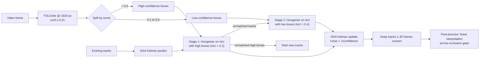

# Tracking Pedestrians Through Dense Crowds

**Aman Dangar · IIT Delhi · CAIC Summer of Technology 2026, Computer Vision track**

Multi-object tracking (MOT) on crowd video with **up to 246 people in a single frame**. At that density
people constantly hide each other, detector confidence collapses on half-visible bodies, and a
standard SORT tracker loses identities every few frames. This repo is my attempt to keep identities
alive through occlusion, built from first principles rather than calling `model.track()`.

The final tracker is in [`Final Project/2025TT11556_FinalProject.py`](Final%20Project/2025TT11556_FinalProject.py)
(~350 lines, NumPy + SciPy + FilterPy + Ultralytics).

---

## The problem, in one picture



## Design decisions and why

| Decision | Why |
|---|---|
| **Two-stage association (ByteTrack, written from scratch)** | An occluded person still produces a weak detection. SORT throws it away with the background noise. Matching *existing tracks* against low-score boxes in a second pass recovers them without letting low-score boxes start new (likely false) tracks. |
| **Stricter IoU gate for the low-score pass (0.4 vs 0.2)** | Low-score boxes are noisier, so I only accept them when they overlap the predicted position strongly. This trades a little recall for fewer identity switches. |
| **Noise-scale-adaptive (NSA) Kalman filter** | Measurement noise *R* is scaled by `1 + 10·(1 − confidence)`. A confident detection pulls the state hard, while a doubtful one is mostly ignored in favour of the motion model. |
| **YOLOv8x at 1920 px, detector threshold 0.01** | In a crowd, missed detections, not association, are the main failure. Larger model + higher resolution raises recall on small, distant people, and the very low threshold hands every candidate to the tracker, which decides. |
| **Track interpolation as post-processing** | When a track disappears for a few frames and reappears, I fill the gap by linear interpolation of box coordinates. Gaps are exactly where IDF1 is lost. |
| **Tracks survive 30 frames unseen** | Long enough to bridge a typical occlusion, short enough not to re-attach to a different person. |

## What I learned

- **Recall dominates in dense scenes.** Switching to a bigger detector at higher resolution changed results more than any tuning of the matcher.
- **Confidence is information, not just a filter.** Using it twice, to route boxes between association stages and to scale Kalman noise, is the core idea of the whole pipeline.
- **Motion-only tracking has a ceiling.** When two people cross while both are occluded, IoU alone cannot tell them apart.

## Limitations and next steps

- **Appearance features.** Add a re-identification embedding (DeepSORT / BoT-SORT style) so identities survive long occlusions and crossings.
- **Camera-motion compensation.** Global motion estimation before the Kalman predict step for moving-camera clips.
- **Ablation.** Measure each component's contribution (two-stage vs one-stage, NSA vs fixed noise, with vs without interpolation) on HOTA / IDF1 / MOTA, so every design choice above is backed by a number.

## Earlier weeks (foundations for the final tracker)

| Week | Task | Folder |
|---|---|---|
| 1 | CNN from scratch in PyTorch on Fashion-MNIST | [`Week 1`](Week%201) |
| 2 | ResNet-18 with data augmentation on EuroSAT satellite images | [`Week 2`](Week%202) |
| 3 | Transfer learning: frozen ImageNet ResNet-18 backbone, new head | [`Week 3`](Week%203) |
| 4 and 5 | Object detection with YOLOv8, Kalman filter + Hungarian matching (SORT) | [`Week 4&5`](Week%204%265) |
| Final | Dense-crowd MOT (this README) | [`Final Project`](Final%20Project) |

## Run it

```bash
pip install ultralytics filterpy scipy numpy opencv-python
python "Final Project/2025TT11556_FinalProject.py"
```

The course syllabus that framed this work is kept in [`COURSE.md`](COURSE.md).

---
*Contact: amandangar102@gmail.com · [LinkedIn](https://www.linkedin.com/in/amandangar/)*
